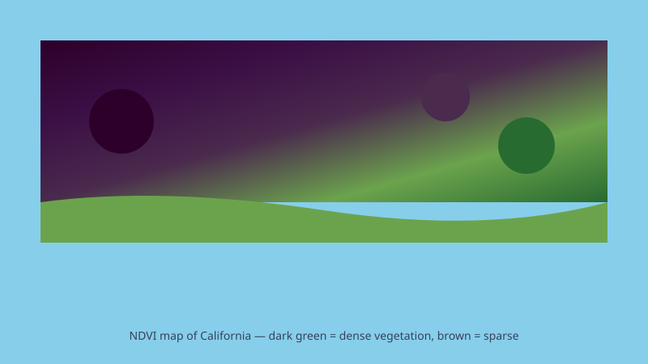

## Introduction

Satellite remote sensing has revolutionized how we monitor vegetation at scale.
Instead of measuring individual plants, we can now track ecosystem health
across entire continents — every few days — using freely available satellite
data. This post walks through the core concepts, key indices, and practical
applications.

### What Are Vegetation Indices?

Vegetation indices are mathematical combinations of surface reflectance
measured at different wavelengths. Healthy vegetation absorbs most visible
light (for photosynthesis) and reflects strongly in the near-infrared (NIR)
portion of the spectrum.

By comparing how much light is absorbed versus reflected, we can quantify:

- **Leaf area** and biomass
- **Photosynthetic activity**
- **Plant stress** or water content
- **Land-cover change** over time

### The NDVI

The Normalized Difference Vegetation Index (NDVI) is the most widely used
vegetation index. It is calculated as:

```
NDVI = (NIR - Red) / (NIR + Red)
```

Where `NIR` is near-infrared reflectance and `Red` is red-band reflectance.

NDVI values range from -1 to +1:

- **-1 to 0**: Water, barren land, or snow
- **0.1 to 0.2**: Sparse vegetation (grasslands)
- **0.3 to 0.6**: Moderate vegetation (forests, crops)
- **0.7 to 1.0**: Dense, healthy vegetation (tropical forests)



### Data Sources

#### Landsat

NASA and USGS operate the Landsat program, providing continuous Earth
observation since 1972. Landsat 8 and 9 carry the Operational Land Imager
(OLI), which captures data in 9 spectral bands at 30 m resolution.

#### Sentinel-2

The European Space Agency's Sentinel-2 mission provides even higher
spatial resolution (10 m) and a 5-day revisit cycle. Its 13 spectral
bands include two red-edge bands that are particularly useful for
vegetation monitoring.

#### MODIS

For broad-scale monitoring, MODIS on NASA's Terra and Aqua satellites
provides daily global coverage at 250 m to 1 km resolution, ideal for
tracking phenology and seasonal dynamics.

### Practical Applications

#### Precision Agriculture

Farmers use NDVI maps to identify irrigation problems, nutrient deficiencies,
and pest damage before symptoms are visible to the naked eye. This allows
for targeted interventions rather than field-wide treatments.

#### Forest Management

Forest services monitor tree health after wildfires, storms, or disease
outbreaks. Time-series NDVI analysis reveals recovery patterns and helps
prioritize restoration efforts.

#### Climate Research

Researchers track long-term vegetation trends to study the impacts of climate
change on ecosystems. Shifts in NDVI seasonality can indicate changes in
growing seasons or migration patterns.

### Getting Started

If you're new to satellite data analysis, here's a practical roadmap:

1. **Choose a platform**: Google Earth Engine provides free, browser-based
   access to petabytes of satellite data with no storage required.
2. **Start simple**: Calculate NDVI for a single scene over your area of
   interest.
3. **Build a time series**: Compare multiple dates to see seasonal patterns.
4. **Validate with ground truth**: Compare your results to field
   measurements or higher-resolution aerial imagery.

### Conclusion

Satellite-derived vegetation indices are powerful tools for monitoring ecosystem
health at scales that would be impossible with ground-based methods alone.
While the math behind indices like NDVI is straightforward, the insights they
provide — from tracking drought impacts to guiding sustainable agriculture —
are profound.

Whether you're a researcher, conservationist, or farmer, understanding these
tools opens up new possibilities for data-driven environmental stewardship.

## Further Reading

- [NASA Earthdata: Vegetation Indices](https://earthdata.nasa.gov/)
- [Google Earth Engine Documentation](https://developers.google.com/earth-engine)
- [USGS Landsat Missions](https://landsat.usgs.gov/)
