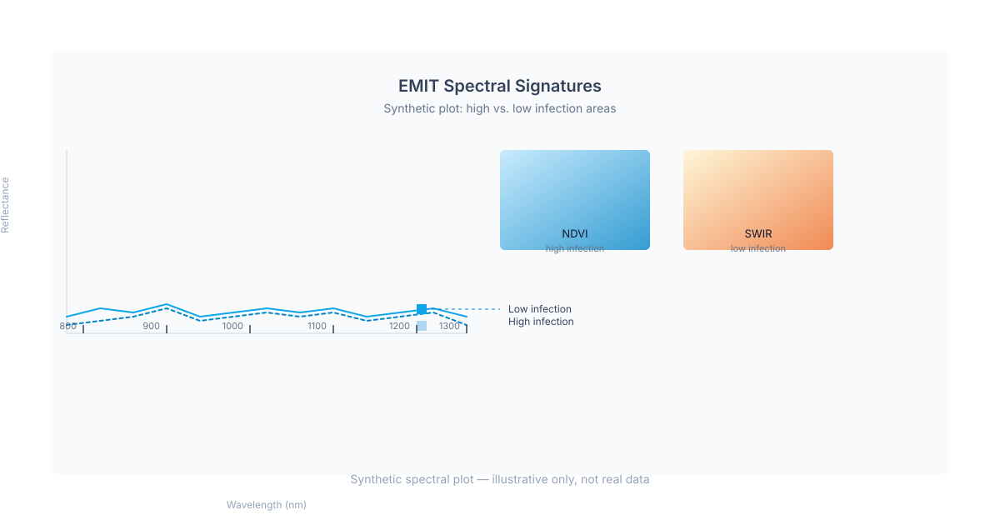
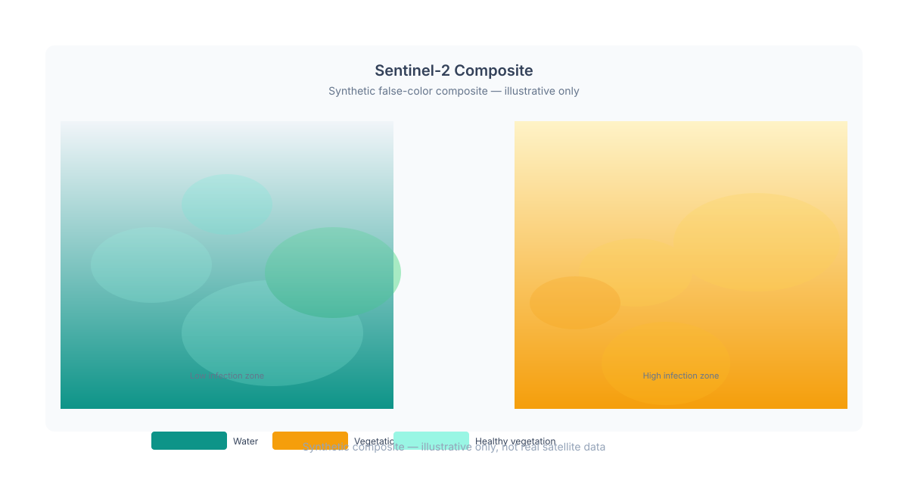
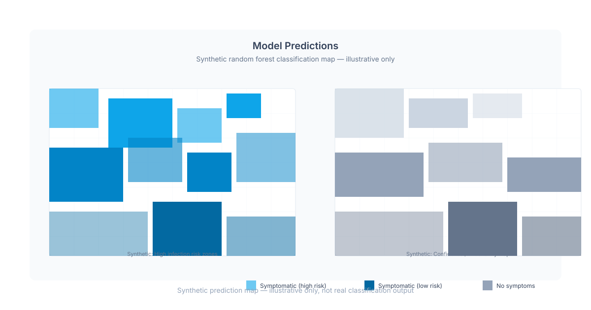

<!-- TODO(owner): This is sample/illustrative content demonstrating the
     portfolio template. Replace with your own project description, title,
     images, tags, and links. The title, excerpt, and all image alt text
     clearly indicate this is a synthetic demonstration. Set
     `draft: true` to hide, or leave `draft: false` to display. -->

## Summary

This is a **template example** showing how to structure a project entry in the
portfolio. It demonstrates the content format — title, date, tags, excerpt,
cover image, body images with alt text, and optional links — using entirely
synthetic visualization concepts.

The fictional project below illustrates a hypothetical spectral signature
analysis workflow. The SVG illustrations are purpose-made and clearly synthetic:
they use abstract geometric shapes, placeholder data, and deliberately
non-realistic color schemes. They are **not** real satellite imagery, **not**
from any actual field site, and **not** associated with any real research
program, institution, or individual.

The cover image shows a synthetic visualization dashboard with abstract
bar-chart elements, colored polygonal annotations, and a circular legend —
all rendered in a consistent sky-blue palette to match the site's design
system. The body images show placeholder spectral plots, false-color composites,
and model prediction maps.

## Spectral Analysis Concepts

This fictional project concept explores how different data sources represent
landscape features. Hyperspectral imaging captures hundreds of narrow spectral
bands, allowing detailed material identification, while multispectral imaging
captures fewer broader bands at higher spatial resolution.

The synthetic visualizations below illustrate abstract concepts:

The first illustration shows spectral signatures represented as abstract curved
polylines across a simplified wavelength axis. The second illustration presents
a false-color composite using gradient-filled rectangles to represent how
different feature classes might appear under different spectral band combinations.

The composite visualization demonstrates how color mappings can highlight or
obscure subtle spectral differences. In this synthetic example, distinct color
palettes illustrate the concept of band combination selection.

The prediction map illustrates how a hypothetical classification model might
partition a landscape into discrete categories. The grid-pattern background
and uniform color blocks are clearly synthetic and do not represent any real
geographic area.

## Template Usage

To create your own project:

1. Delete this directory or replace its contents.
2. Edit the frontmatter `title`, `date`, `tags`, `excerpt`, and `image` to
   match your project.
3. Set `draft: true` to hide this example from your published site, or leave
   `draft: false` to keep it visible.
4. Replace the body text and images with your own content.
5. Update or remove the `links` array below.

**Links:**

- [Template documentation](/docs/content-authoring)
- [License information](/docs/architecture/decisions/0007-licensing-policy)
